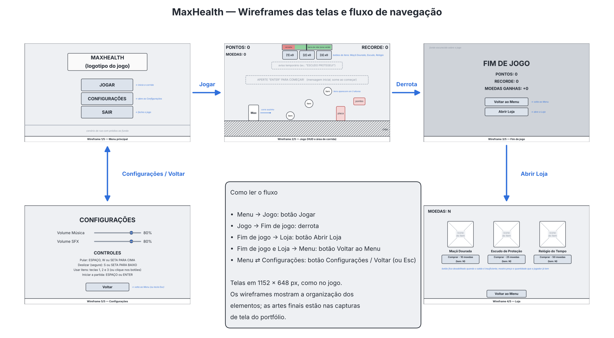

# MaxHealth

**Endless runner 2D · Saúde e Bem-Estar (ODS 3 — ONU)**

Projeto de Extensão Curricular do curso de Ciência da Computação da UniFil, desenvolvido na Godot Engine 4.6 e exportado para HTML5/Web. O jogo é executado diretamente no navegador, sem necessidade de instalação.

## Sobre o jogo

No MaxHealth, o personagem corre automaticamente por uma rua da cidade. O jogador deve coletar itens saudáveis, evitar itens prejudiciais e desviar de obstáculos. Cada escolha produz consequência imediata na barra de vida, o que transforma hábitos do cotidiano em dinâmica de jogo.

O projeto está alinhado ao ODS 3 (Saúde e Bem-Estar) da Organização das Nações Unidas e funciona como ferramenta pedagógica de conscientização sobre alimentação e bem-estar, sem depender de textos explicativos durante a partida.

## Controles

| Ação | Teclas |
|---|---|
| Iniciar a corrida | `Espaço` ou `Enter` |
| Pular | `Espaço`, `W` ou `↑` |
| Deslizar | `S` ou `↓` (mantida pressionada) |
| Queda rápida | `S` ou `↓` pressionada durante o salto |
| Usar Maçã Dourada, Escudo ou Relógio | `1`, `2` e `3` (ou botões da HUD) |

O jogo requer computador com navegador atualizado e teclado. Não há suporte a dispositivos móveis. A lista de controles também é exibida na tela de Configurações.

## Mecânicas principais

- **Itens saudáveis** (maçã, água e cenoura) aumentam a barra de vida e geram XP.
- **Itens prejudiciais** (refrigerante, hambúrguer e donut) reduzem a barra de vida.
- **Obstáculos** (placas e pombos) causam derrota imediata, exceto quando há proteção ativa.
- **Barra de vida:** a partida termina quando a barra atinge a zona vermelha. Ao ser completada, a barra concede pontos extras e retorna ao ponto médio.
- **Progressão:** o XP acumulado é convertido em moedas, utilizadas na loja para adquirir itens de proteção.
- **Dificuldade:** a velocidade e a quantidade de obstáculos aumentam de forma gradual e contínua, sem fases separadas.

### Itens de proteção

| Item | Efeito |
|---|---|
| Maçã Dourada | Revive o personagem uma vez, com a barra retornando ao ponto médio |
| Escudo de Proteção | Absorve uma colisão com obstáculo |
| Relógio do Tempo | Reduz a velocidade do cenário por alguns segundos |

Os itens são consumíveis, ativados pelo jogador antes do perigo. O preço de cada item, em moedas, é exibido na tela da loja.

## Interface

| Elemento | Função |
|---|---|
| Barra de vida | Indica a vida atual, com zona vermelha e zona verde |
| Pontuação e recorde | Exibem os pontos da partida e o melhor resultado da sessão |
| Saldo de moedas | Indica as moedas disponíveis para a loja |
| Botões de itens | Mostram o estoque e permitem o uso dos itens de proteção |

### Navegação entre telas

Menu → Jogo → Fim de jogo → (Menu ou Loja) → Menu. O menu também dá acesso às Configurações, onde o volume da música e dos efeitos é ajustado e mantido no navegador.



## Tecnologias

- **Engine:** Godot Engine 4.6 (2D, exportação HTML5/Web, sem threads)
- **Arte:** LibreSprite (pixel art)
- **Áudio:** BeepBox (trilha) e ferramentas gratuitas de edição (efeitos sonoros)
- **Versionamento e hospedagem:** GitHub e GitHub Pages

O projeto não possui orçamento e utiliza apenas ferramentas gratuitas. Também não depende de servidores externos, APIs ou banco de dados remoto.

## Estrutura do repositório

```
MaxHealth-Game/
├── documents/    # Vision Document, Game Design Document e imagens dos diagramas
├── audio/        # Trilha sonora e efeitos sonoros
├── sprites/      # Sprites do jogo
└── README.md
```

## Equipe

| Integrante | Função | GitHub |
|---|---|---|
| Lucas Eduardo da Silva | Cria os efeitos sonoros (SFX) e cuida da documentação do portfólio e do GitHub | [@lucasG103](https://github.com/lucasG103) |
| Vitor Hugo Cardozo de Abreu | Desenha os sprites e implementa o jogo no Godot | [@vitorcdz](https://github.com/vitorcdz) |
| Carlos Henrique Yudi Endo | Dirige a arte e organiza as ideias do projeto, cuidando da parte criativa | [@CarlosHenriqueYudi](https://github.com/CarlosHenriqueYudi) |
| Davi Daisuke Yazima da Silva | Programa o jogo no Godot e otimiza as mecânicas | [@Davidayz](https://github.com/Davidayz) |

## Documentação

- [Vision Document](documents/VISION_DOCUMENT.md)
- [Game Design Document (GDD)](documents/GAME_DESIGN_DOCUMENT.md)
- [Portfólio do projeto](https://sites.google.com/edu.unifil.br/portflio-jogo/p%C3%A1gina-inicial)

## Limitações conhecidas

- Moedas, estoque de itens e recorde não são salvos: valem apenas durante a sessão do navegador. Os volumes de música e efeitos são mantidos.
- O jogo não possui suporte a celulares e tablets.

## Impacto social

O jogo pode ser utilizado em escolas, projetos sociais e atividades comunitárias como apoio pedagógico. Por ser gratuito e acessível por link, sem necessidade de instalação, busca democratizar o acesso à educação em saúde.

## Projeto de extensão

Ao término do projeto, o repositório e os artefatos associados serão transferidos para o GitHub da UniFil.
