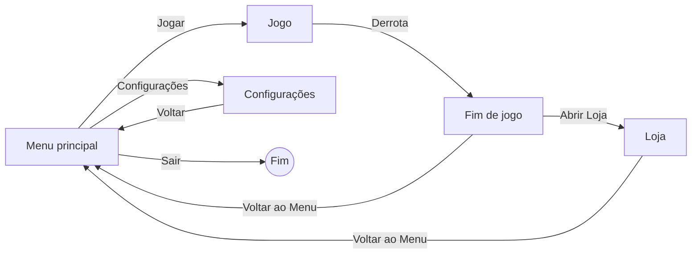

# Game Design Document — MaxHealth

> Documento alinhado à versão final do jogo (build Web, Godot 4.6). Onde há diferença entre uma ideia inicial e o que foi implementado, vale o que está descrito aqui.

## 1. Ficha Técnica

| Item | Descrição |
|---|---|
| Título | MaxHealth |
| Gênero | Endless Runner 2D (mecânica cíclica e rejogável) |
| Engine | Godot Engine 4.6 (somente 2D) |
| Plataforma | Navegador (exportação HTML5/Web), sem instalação |
| Dispositivo-alvo | PC/notebook com teclado (sem suporte mobile) |
| Servidor / banco de dados / APIs | Não utiliza. Jogo 100% estático e client-side |
| Hospedagem | GitHub Pages (repositório público) |
| Tema | Saúde e bem-estar (ODS 3 — ONU) |
| Equipe | 4 integrantes (ver README) |

## 2. Proposta e Narrativa

Max é um garoto que corre sem parar por uma rua da cidade. No caminho aparecem escolhas do dia a dia: alimentos que fortalecem (maçã, água, cenoura), alimentos que prejudicam (refrigerante, hambúrguer, donut) e perigos urbanos (placas de sinalização e pombos). Quem joga decide, em frações de segundo, o que coletar e o que evitar.

Não há texto explicativo durante a partida: a mensagem é transmitida pela própria mecânica. O que faz bem aproxima o personagem de uma barra cheia (e de pontos extras); o que faz mal o leva à "zona vermelha" e ao fim da corrida.

## 3. Público-Alvo

- **Principal:** crianças, adolescentes e jovens estudantes.
- **Secundário:** educadores e famílias que busquem um apoio lúdico para conversar sobre hábitos saudáveis.
- **Requisitos de acesso:** computador com navegador atual e teclado; nenhum conhecimento prévio de jogos.

## 4. Objetivos

**Do jogador**
- Sobreviver o máximo possível, acumulando pontos e batendo o próprio recorde.
- Coletar itens saudáveis para encher a barra de vida e gerar XP.
- Converter XP em moedas e comprar itens de proteção na loja para durar mais nas próximas corridas.

**Pedagógico**
- Reforçar, pela repetição e pela consequência imediata, a distinção entre escolhas saudáveis e prejudiciais.

## 5. Controles

| Ação | Teclas |
|---|---|
| Iniciar a corrida | `Espaço` ou `Enter` |
| Pular | `Espaço`, `W` ou `↑` |
| Deslizar (segure) | `S` ou `↓` (o personagem fica deitado por no mínimo 0,35 s, mesmo com toque rápido) |
| Queda rápida | Segure `S` ou `↓` no ar para voltar ao chão mais depressa |
| Usar Maçã Dourada / Escudo / Relógio | `1` / `2` / `3` (ou clique nos botões da HUD) |
| Menus | Mouse (botões); `Esc` volta nas Configurações |

A lista de controles também aparece dentro do jogo, na tela de Configurações.

## 6. Mecânicas e Regras

### 6.1 Movimentação
- A corrida é automática. A velocidade inicial é 10 (unidades por quadro) e aumenta com a pontuação, até o máximo de 25.
- O jogador pula e desliza. Os itens aparecem em três alturas (chão, pulo curto e pulo alto): o deslize desvia de alguns elementos e o pulo alcança outros.

### 6.2 Itens e obstáculos

| Elemento | Exemplos | Efeito |
|---|---|---|
| Item saudável | maçã, água, cenoura | +10 na barra de vida e +50 XP |
| Item prejudicial | refrigerante, hambúrguer, donut | −10 na barra de vida |
| Obstáculo de chão | duas variações de placa de sinalização | Derrota imediata (sem proteção ativa) |
| Obstáculo aéreo | pombo (aparece na dificuldade máxima) | Derrota imediata (sem proteção ativa) |

- Itens saudáveis e prejudiciais surgem com 50% de chance cada, a intervalos de 450 a 900 px.
- Itens e obstáculos nunca nascem a menos de 400 px um do outro.

### 6.3 Barra de vida
- Escala de 0 a 100, começando em **50**.
- **Zona vermelha (até 25):** ao chegar nela, a partida termina.
- **Zona verde (acima de 25):** faixa segura.
- **Barra cheia (100):** o jogador ganha **+100 pontos** e a barra volta para 50. O ponteiro anima até o fim da barra, brilha e retorna ao meio.
- Consequência prática: partindo de 50, três itens prejudiciais seguidos terminam a corrida; cinco itens saudáveis seguidos completam a barra.

### 6.4 Itens de proteção (comprados na loja, usados na corrida)

O jogador **ativa** o item antes do perigo (tecla ou botão). Escudo e Maçã Dourada ficam "armados" até serem necessários; o Relógio age imediatamente.

| Item | Preço | Efeito | Observações |
|---|---|---|---|
| **Maçã Dourada** | 10 moedas | Reviver: salva o jogador de uma colisão fatal ou de entrar na zona vermelha; a barra volta para 50 | Concede 1,5 s de invulnerabilidade |
| **Escudo de Proteção** | 25 moedas | Absorve uma colisão com obstáculo e o remove | Concede 1,5 s de invulnerabilidade |
| **Relógio do Tempo** | 50 moedas | Reduz a velocidade do cenário para 50% por 8 s | A pontuação continua na velocidade normal |

- São **consumíveis**: cada compra adiciona 1 unidade ao estoque; cada ativação consome 1 unidade.
- Só um efeito de cada tipo pode estar ativo por vez. Se o Escudo e a Maçã estiverem ativos juntos, o Escudo é consumido primeiro. O personagem muda de animação enquanto um item está ativo.

### 6.5 Dificuldade
- Aumenta de forma contínua, sem fases separadas: a cada 5.000 de pontuação interna sobe um nível (máximo 2).
- Nível 0: 1 placa por vez. Nível 1: grupos de até 2 placas. Nível 2: grupos de até 3 placas e, em metade das ocorrências, pombos aéreos.

### 6.6 Condições de derrota
1. Colidir com obstáculo sem Escudo e sem Maçã Dourada ativos (e fora da invulnerabilidade).
2. Barra de vida chegar à zona vermelha (≤ 25) sem Maçã Dourada ativa.

## 7. Pontuação, XP e Moedas

| Conceito | Regra |
|---|---|
| Pontos | Acumulados pela distância percorrida (pontuação interna ÷ 10), mais bônus de **+100** por barra cheia |
| Recorde | Maior pontuação da sessão, exibido durante a corrida e no Game Over |
| XP | Gerado **apenas** por itens saudáveis (+50 cada) |
| Moedas | **100 XP = 1 moeda** (2 itens saudáveis = 1 moeda), convertidas automaticamente durante a corrida |
| Moedas da partida | Mostradas no Game Over como "Moedas ganhas" |

O saldo inicial de moedas é **0**. Moedas, estoque de itens e recorde valem durante a sessão do navegador (não há salvamento desses dados; ver seção 15).

## 8. Loja

Acessada pelo botão "Abrir Loja" da tela de Game Over (não há atalho no menu inicial). A tela mostra o saldo de moedas, o preço e a quantidade que o jogador já possui de cada item. Os botões de compra ficam desabilitados quando o saldo é insuficiente. O botão "Voltar ao Menu" encerra a visita.

| Item | Preço (moedas) |
|---|---|
| Maçã Dourada | 10 |
| Escudo de Proteção | 25 |
| Relógio do Tempo | 50 |

## 9. Configurações

Tela acessada pelo menu inicial:
- **Volume da música** e **Volume dos efeitos (SFX)**, de 0 a 100% (padrão 80%).
- Lista dos controles do jogo.
- Os volumes são **salvos no navegador** (arquivo de configuração do Godot) e reaplicados nas próximas visitas.
- Botão "Voltar" (ou `Esc`) retorna ao menu.

## 10. HUD (durante a partida)

- **Barra de vida** com zona vermelha, zona verde e ponteiro animado.
- **Pontuação** e **recorde**.
- **Saldo de moedas** ("MOEDAS: N").
- **Botões de itens** `[1] ×N`, `[2] ×N`, `[3] ×N`, com a quantidade em estoque; mostram o estado ativo e, no Relógio, a contagem regressiva.
- **Avisos temporários** ("ESCUDO PROTEGEU!", "MAÇÃ DOURADA: REVIVEU!", "BARRA CHEIA! +100 PONTOS").

## 11. Estrutura de Telas e Navegação



### Wireframes esquemáticos (baixa fidelidade)

```
MENU                         JOGO (HUD)
+----------------------+     +--------------------------------------+
|       MAXHEALTH      |     | [==vermelho|=====verde=====]  MOEDAS |
|                      |     | PONTOS   RECORDE        [1] [2] [3]  |
|      [ Jogar ]      |     |                                      |
|   [ Configurações ]  |     |        (aviso temporário)            |
|      [ Sair ]        |     |   Max ->   item   placa    pombo     |
+----------------------+     +--------------------------------------+

FIM DE JOGO                  LOJA
+----------------------+     +--------------------------------------+
|     FIM DE JOGO      |     |  MOEDAS: N                           |
|  PONTOS:   N         |     |  [Maçã]      [Escudo]    [Relógio]   |
|  RECORDE:  N         |     |  10 moedas   25 moedas   50 moedas   |
|  MOEDAS GANHAS: +N   |     |  (tem: N)    (tem: N)    (tem: N)    |
|  [Voltar ao Menu]    |     |           [ Voltar ao Menu ]         |
|  [Abrir Loja]        |     +--------------------------------------+
+----------------------+

CONFIGURAÇÕES
+--------------------------------------+
|            CONFIGURAÇÕES             |
|  Volume Música  [=======---]  80%    |
|  Volume SFX     [=======---]  80%    |
|  CONTROLES (lista de teclas)         |
|             [ Voltar ]               |
+--------------------------------------+
```

> Esquemas de organização; as capturas das telas reais estão no portfólio do projeto.

## 12. Estrutura de Cenas do Godot

```
Autoload
└── DadosJogo (scripts/dados_jogo.gd)   # moedas, XP, recorde, estoque e preços dos itens,
                                         # volumes, música do menu, SFX, atalhos de teclado

res://cenas/
├── Menu.tscn                       # Control: fundo, botões Jogar / Configurações / Sair
├── configuracoes.tscn              # Control: sliders de volume, lista de controles, Voltar
├── jogo.tscn                       # Node2D (jogo.gd): cena principal
│   ├── ParallaxBackground          # (parallax_background.tscn)
│   ├── Camera2D
│   ├── chao                        # (chao.tscn)
│   ├── Menino                      # (menino.tscn) CharacterBody2D + AnimatedSprite2D
│   ├── MSG_INI                     # (MSG_INI.tscn) mensagem inicial, pontos e recorde
│   ├── Musica                      # trilha da partida
│   └── HUD                         # (hud.tscn) CanvasLayer
├── game_over.tscn                  # CanvasLayer, instanciada ao fim da partida
├── loja.tscn (+ loja.gd)           # Control: 3 itens + botão de voltar
├── placa_1.tscn, placa_2.tscn      # obstáculos de chão (Area2D)
├── Pombo.tscn                      # obstáculo aéreo (Area2D)
└── item_coletavel.tscn             # item bom/ruim (Area2D), configurado por código

res://scripts/
jogo.gd · menino.gd · hud.gd · game_over.gd · menu.gd · configuracoes.gd · item_coletavel.gd · pombo.gd · dados_jogo.gd

res://audios/
menu.ogg (menu e configurações) · jogo.ogg (partida) · sfx_bom.wav · sfx_ruim.wav
```

## 13. Casos de Uso

Ator único: **Jogador**.

| ID | Caso de uso | Descrição |
|---|---|---|
| UC01 | Jogar partida | Escolhe "Jogar" no menu e inicia a corrida com Espaço ou Enter |
| UC02 | Pular | Desvia de obstáculos e alcança itens elevados |
| UC03 | Deslizar | Passa por baixo de elementos altos |
| UC04 | Coletar item | Colide com item saudável ou prejudicial e altera vida e XP |
| UC05 | Usar item de proteção | Ativa Maçã Dourada, Escudo ou Relógio (teclas 1 a 3 ou botões) |
| UC06 | Consultar pontuação e recorde | Acompanha na HUD e no Game Over |
| UC07 | Acessar a loja | Abre a loja pela tela de Game Over |
| UC08 | Comprar item | Troca moedas por unidades de item de proteção |
| UC09 | Voltar ao menu | A partir do Game Over ou da loja |
| UC10 | Ajustar volume | Altera volume de música e efeitos na tela de Configurações |
| UC11 | Sair | Encerra pela opção "Sair" do menu |

## 14. MVP (versão mínima jogável)

O MVP é o ciclo completo: **menu → corrida → coleta e obstáculos → barra de vida → Game Over → nova partida**, com pontuação e recorde. A loja, os itens de proteção, as configurações de áudio e os efeitos sonoros foram acrescentados sobre esse núcleo.

## 15. Requisitos Técnicos, Restrições e Limitações

**Requisitos da extensão atendidos**
- Godot, exclusivamente 2D, exportado em HTML5, executado no navegador, sem instalação.
- Totalmente estático: todos os arquivos locais, sem API externa, banco de dados remoto ou autenticação.
- Mecânica cíclica e rejogável.
- Exportação sem suporte a threads, compatível com hospedagem estática (GitHub Pages).

**Limitações conhecidas**
- Moedas, estoque de itens e recorde não são salvos: fechar ou recarregar a página zera esses dados. Apenas os volumes são salvos.
- Efeitos sonoros apenas para item saudável e item prejudicial; colisão, derrota, uso de item e compra não têm SFX.
- No navegador, o botão "Sair" tenta fechar a aba e, logo em seguida, troca a página por uma tela em branco (o navegador pode bloquear o fechamento da aba).
- Sem suporte a celulares e tablets (controles por teclado).

## 16. Áudio e Arte

- **Arte:** pixel art produzida em LibreSprite (personagem, itens, obstáculos, cenário).
- **Trilha sonora:** produzida pela equipe, em duas faixas (menu e partida), com repetição contínua.
- **Efeitos sonoros:** dois efeitos curtos, de coleta de item saudável e de item prejudicial; o volume é controlado nas Configurações.

## 17. Proposta Pedagógica

O jogo associa, de forma lúdica, hábitos saudáveis (itens bons e proteções) a hábitos prejudiciais (itens ruins e obstáculos), reforçando a distinção pela repetição, pelo risco imediato e pela recompensa progressiva do sistema de moedas, sem depender de texto expositivo dentro da jogabilidade. A abordagem se alinha ao **ODS 3 — Saúde e Bem-Estar**.
